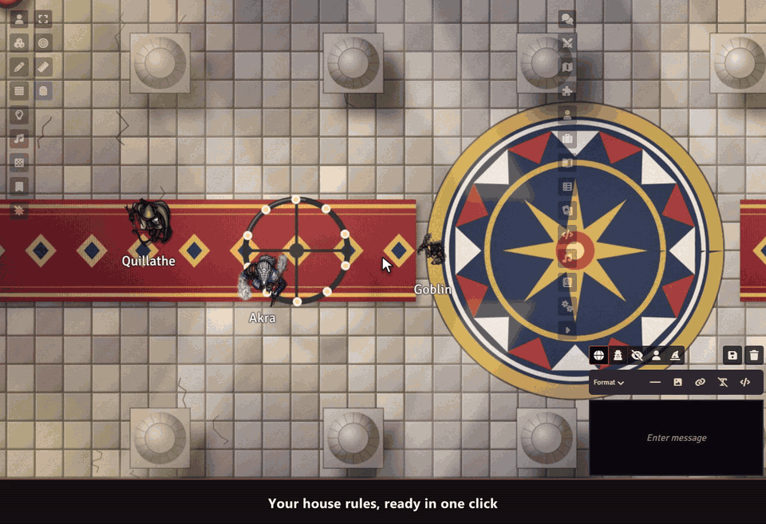

# Sephral’s Roll Triggers

**Natural 20? Roll on the crit table. Natural 1? Time for the fumble table. Doubles on a d100? Note an improvement.** Roll Triggers brings your house rules to life: it watches every roll and every combat and reacts the way your table wants.

## Highlights

* **Ready rules in one click:** a gallery of house rules you read in plain words and add with one click, then tweak. It shows what fits your game system: a critical hit table, Inspiration for a natural 20, a warning for a failed death save, a hero point in Pathfinder 2e.
* **React to combat too:** act at the start or end of a turn, at the start of a round or every few rounds, when a fight begins or ends, or when an effect on a fighter ends.
* **React to any special roll:** natural highs and lows, exact values, doubles and triples, totals, thresholds, degrees of success, or combinations of dice.
* **Make something happen:** post a chat message, roll on a table, run a macro, link a journal entry or send the GM a private note.
* **Bring the moment to life:** play a sound, show an image, roll an extra die, knock someone prone or hand out inspiration and bennies.
* **Test before you play:** try any roll on the test bench and see which triggers fire and why, without touching the chat.
* **You stay in charge:** fire automatically, ask the GM first, or show a chat button. Roll Triggers never changes or rerolls a result.
* **Only when it fits:** limit a trigger to a roll type, an actor, an item, a scene, combat or the player who rolled.
* **Share your house rules:** export triggers and profiles and import them in another world.

## Ideas for your table

* Draw from a critical hit table on a natural 20
* Whisper the GM a note when a hidden roll crosses a threshold
* Play a fanfare and grant inspiration on a natural 20
* Run a macro on snake eyes, triples or a maximum roll
* Remind yourself of the weather every third round or roll an event table in round five

## How it works

1. Click the Roll Triggers icon in the GM toolbar.
2. Open the ready rules and add the ones you like, or create your own trigger.
3. Play. When a roll or a combat event matches, the trigger fires.

## Install

Search for **Roll Triggers** in Foundry's module browser or open the [package page](https://foundryvtt.com/packages/sephrals-roll-triggers).

Foundry VTT 13 and 14 · any game system · English and German

## Learn more

The [manual](MANUAL.md) explains the ready rules, combat triggers, every match type, filter, action and execution mode, the test bench, plus profiles, import and export.

Questions or ideas? Join us on [Discord](https://discord.gg/7BjCgDYaBP). Looking for more? See [all modules by Sephral](https://github.com/Sephral).

## License

See [LICENSE.md](LICENSE.md).
