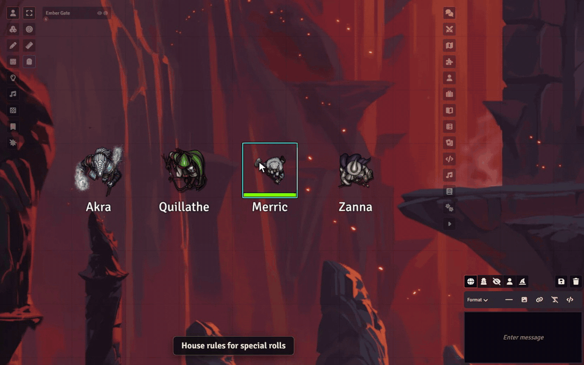

# Sephral’s Roll Triggers

**Natural 20? Roll on the crit table. Natural 1? Time for the fumble table. Doubles on a d100? Note an improvement.** Roll Triggers brings your house rules to life: it watches every roll and reacts the way your table wants.

## Highlights

* **React to any special roll:** natural highs and lows, exact values, doubles and triples, totals, thresholds, degrees of success, or combinations such as *one die shows 1 AND the other shows 2*.
* **Make something happen:** post a chat message, roll on a table, run a macro, link a journal entry or send the GM a private note.
* **Bring the moment to life:** play a sound, show an image, roll an extra die, knock someone prone or hand out inspiration and bennies.
* **Test before you play:** try any roll on the test bench and see which triggers fire and why, without touching the chat.
* **You stay in charge:** fire automatically, ask the GM first, or show a chat button and decide later.
* **Only when it fits:** limit a trigger to a roll type, an actor, an item, a scene, combat or the player who rolled.
* **Ready for your system:** starter profiles for D&D 5e, Pathfinder 2e, Call of Cthulhu, Daggerheart, DSA5, WFRP4e, Savage Worlds, Cyberpunk RED, Blades in the Dark, GURPS and more.
* **Share your house rules:** export triggers and profiles and import them in another world.
* **Fair dice:** Roll Triggers never changes or rerolls a result. It only reacts.

## Ideas for your table

* Draw from a critical hit table on a natural 20
* Post a chat button on a natural 1 so the GM can decide whether the mishap happens
* Whisper the GM a note when a hidden roll crosses a threshold
* Play a fanfare and grant inspiration on a natural 20
* Show a dramatic image and knock the attacker prone on a fumble
* Run a macro on snake eyes, triples or a maximum roll
* Link the house rules journal when a special pattern comes up

## How it works

1. Click the Roll Triggers icon in the GM toolbar.
2. Import the starter profile for your system or create your own trigger.
3. Play. When a roll matches, the trigger fires.

## Install

Search for **Roll Triggers** in Foundry's module browser or open the [package page](https://foundryvtt.com/packages/sephrals-roll-triggers).

Foundry VTT v13 and v14 · any game system · English and German

## Learn more

The [manual](MANUAL.md) explains every match type, filter, action and execution mode, the test bench, plus profiles, import and export.

Questions or ideas? Join us on [Discord](https://discord.gg/7BjCgDYaBP). Looking for more? See [all modules by Sephral](https://github.com/Sephral).

## License

See [LICENSE.md](LICENSE.md).
